<div align="center">

# DMoney API Load Testing with k6

Automated multi-phase performance tests for the DMoney fintech platform, built with Grafana k6.


</div>

---

## Table of Contents

- [Project Overview](#project-overview)
- [Test Scenarios](#test-scenarios)
- [Prerequisites](#prerequisites)
- [Project Files](#project-files)
- [Setup and Execution](#setup-and-execution)
- [Latest Results](#latest-results)
- [Screenshots](#screenshots)
- [Tech Stack](#tech-stack)
- [Author](#author)

---

## Project Overview

This project exercises the DMoney API with a staged, two-minute workload. It measures transaction success rates, request failures, and response times under concurrent virtual users.

**Roles:** Agents, customers, and merchants

**Transactions:** Deposits, send money, and merchant payments

## Test Scenarios

The workload runs four 30-second phases. The configured virtual-user count rises from two to four; k6 reports up to eight VUs across the scenarios.

| Phase | Time | VUs | Transactions |
|:---:|:---:|:---:|---|
| 1 | 0–30s | 2 | Send money, payment |
| 2 | 30–60s | 3 | Deposit, send money, payment |
| 3 | 60–90s | 4 | Deposit, send money, payment |
| 4 | 90–120s | 4 | Payment |

```mermaid
gantt
    title DMoney Load Test Timeline
    dateFormat X
    axisFormat %Ss
    section Phase 1 · 2 VUs
    Send money + payment       :0, 30
    section Phase 2 · 3 VUs
    Deposit + send + payment   :30, 60
    section Phase 3 · 4 VUs
    Deposit + send + payment   :60, 90
    section Phase 4 · 4 VUs
    Payments                   :90, 120
```



The thresholds configured in `script.js` are:

- HTTP request failure rate below 10%.
- HTTP request duration P(95) below 1,000 ms.
- At least 70% success for deposits, send-money transactions, and payments.

## Prerequisites

- [Grafana k6](https://grafana.com/docs/k6/latest/set-up/install-k6/) installed.
- A DMoney test environment and test accounts you are authorized to use.
- Valid bearer tokens for every account in `users.json`, saved locally in `tokens.json`.

## Project Files

```text
dmoney-k6-test/
├── script.js               # Multi-phase k6 workload and thresholds
├── users.json              # Local test account details; keep private
├── tokens.json             # Local bearer tokens; keep private
├── report.html             # Generated HTML report
├── setup_auth.js           # Legacy authentication/setup helper
├── setup_all.js            # User and account setup flow
├── seed_users.js           # Creates test accounts
├── generate_tokens.js      # k6 token-generation utility
├── fetch_tokens.js         # Node.js token utility
├── activate_and_deposit.js # Account activation and initial deposits
├── deposit_balance.js      # Customer funding utility
├── recharge_agents.js      # Agent funding utility
├── recharge_customer.js    # Customer funding utility
├── balance_fix.js          # Balance inspection/adjustment utility
├── check_balances.js       # Account balance inspection
└── check_status.js         # Account/system status utility
```

## Setup and Execution

### 1. Prepare test data and tokens

Make sure `users.json` contains the authorized test accounts and `tokens.json` contains a valid bearer token for each corresponding account. Tokens expire; refresh them through the environment's approved authentication process before a run. Do not paste tokens into source control, chat, or a shared report.

`setup_auth.js` is a legacy helper that retrieves OTP values through a privileged admin endpoint and prints OTPs and bearer tokens. Avoid running it in shared environments or against accounts you do not own or administer. Prefer the platform's approved account-owner authentication flow.

### 2. Run the load test

From the project directory, run:

```bash
# 1. Recharge Agent balances from SYSTEM
k6 run recharge_agents.js

# 2. Run setup_auth to generate fresh JWT tokens
k6 run setup_auth.js

# 3. Paste the generated JSON into tokens.json (or ensure fetch_tokens.js passes 6/6)

# 4. Verify tokens are working (should return 200/201 instead of 403)
k6 run check_status.js

# 5. Run main load test
k6 run script.js
```

The script writes the HTML summary to `report.html` after the run. A breached threshold makes k6 exit with a non-zero status; inspect the failed request and success-rate metrics before changing thresholds.

### 3. Open the report

On macOS:

```bash
open report.html
```

## Latest Results

> Snapshot from `report.html`, generated October 28, 2026. Results describe that run only; they are not a guarantee for future runs.

### Summary

| Metric | Result |
|---|---:|
| Total requests | 230 (1.89 requests/s) |
| Iterations | 86 (0.71 iterations/s) |
| Virtual users | 2 minimum, 8 maximum |
| Thresholds breached | 0 |
| Failed requests | 2 (0.87%) |
| Checks | 228 passed, 2 failed |
| Data received / sent | 0.17 MB / 0.05 MB |

### Response Times

| Metric | Average | Median | Maximum | P(90) | P(95) |
|---|---:|---:|---:|---:|---:|
| HTTP request duration | 221.23 ms | 197.10 ms | 476.07 ms | 311.13 ms | 371.88 ms |
| Deposit response time | 293.75 ms | 274.59 ms | 476.07 ms | 386.48 ms | 414.71 ms |

### Transaction Success

| Transaction | Success rate | Passed | Failed |
|---|---:|---:|---:|
| Send money | 100.00% | 54 | 0 |
| Payment | 100.00% | 118 | 0 |
| Deposit | 96.55% | 56 | 2 |

The run stayed within configured thresholds. Both failed checks were deposit requests; inspect the response details in the report or k6 output to identify their cause.

## Screenshots

Project screenshots are available in the [Google Drive folder](https://drive.google.com/drive/folders/1JxuV2UM3iAmteAeHTjS-Df0wi7MlKVrI?usp=sharing).

## Tech Stack

- [Grafana k6](https://k6.io/) for load generation and threshold checks.
- JavaScript for workload scenarios and custom metrics.
- k6-reporter for the generated HTML summary.
- Node.js for selected local utilities.

## Author

**Md. Tanvir Ahamed**

---

<div align="center">

DMoney API performance test suite

</div>